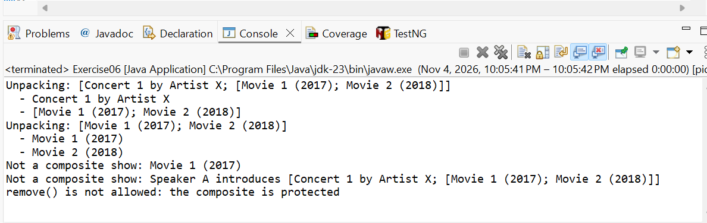
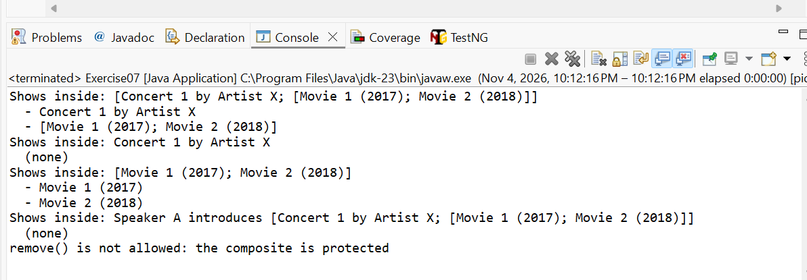
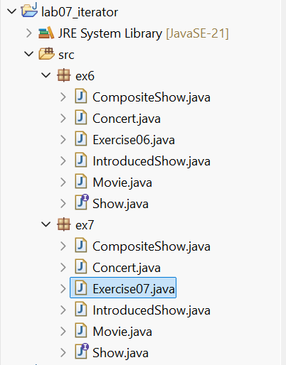

# Lab 07 – Exercise 6 và 7: Iterator cho CompositeShow

| | |
|---|---|
| **Họ và tên** | Lê Anh Khoa |
| **MSSV** | 4651050119 |
| **Lớp** | 46D |
| **Bài** | Lab 07 – Exercise 6 và 7 (Chapter 6, *Introduction to Software Design with Java*) |

---

## 1. Đề bài

Cả hai bài cùng yêu cầu cho phép client "mở gói" một `CompositeShow`, tức lấy ra các show nằm bên trong, bằng `Iterator`. Hai bài khác nhau ở chỗ có sửa interface `Show` hay không:

- **Exercise 6:** làm **không đổi** interface `Show`. Chỉ `CompositeShow` có `iterator()`.
- **Exercise 7:** **sửa** interface `Show` để mọi show đều duyệt được (`Show extends Iterable<Show>`).

Yêu cầu của Lab 07: thực hành và giải thích giải pháp của các bài 6.6 và 6.7.

> Ghi chú: đề Exercise 7 ghi "feature described in Exercise 7", nhưng ý là Exercise 6 (lỗi đánh máy trong sách).

---

## 2. Mã nguồn nền

Repository của sách chỉ có `Show`, `Movie`, `Concert`. Hai lớp còn lại do em tự viết theo các bài trước:

- `CompositeShow` (Exercise 1): show ghép từ 2 đến 5 show khác.
- `IntroducedShow` (Exercise 2): Decorator, show có người dẫn lên giới thiệu.

Cả hai package `ex6` và `ex7` đều có đủ 6 file: `Show`, `Movie`, `Concert`, `CompositeShow`, `IntroducedShow` và lớp chạy thử.

---

## 3. Exercise 6: chỉ CompositeShow có iterator()

`Show` giữ nguyên. Chỉ `CompositeShow` khai báo thêm `Iterable<Show>`:

```java
public class CompositeShow implements Show, Iterable<Show> {

	private final List<Show> aShows = new ArrayList<>();

	@Override
	public Iterator<Show> iterator() {
		return Collections.unmodifiableList(aShows).iterator();
	}
	// description(), runningTime(), copy() như cũ
}
```

Client phải kiểm tra kiểu trước khi duyệt:

```java
private static void unpack(Show pShow) {
	if (pShow instanceof CompositeShow composite) {
		System.out.println("Unpacking: " + pShow.description());
		for (Show subshow : composite) {
			System.out.println("  - " + subshow.description());
		}
	} else {
		System.out.println("Not a composite show: " + pShow.description());
	}
}
```

**Một số điểm đáng chú ý:**

- `iterator()` trả về iterator của `Collections.unmodifiableList(aShows)`, nên client không xóa được show khỏi composite bằng `remove()`.
- `copy()` trả về `new CompositeShow(...)` của đúng package hiện tại, để bản sao vẫn duyệt được.
- Lời giải mẫu dùng `IO.println` và khai báo `CompositeShow2 show = ...` rồi kiểm tra `instanceof CompositeShow2`. Em đổi sang `System.out.println` (chạy được trên Java 21) và khai báo `Show show` để phép `instanceof` có ý nghĩa.

### Kết quả chạy `Exercise06`



| Đoạn trong `main` | Ý nghĩa |
|---|---|
| `Unpacking` hai lần | Mở được cả composite ngoài lẫn composite lồng bên trong |
| `Not a composite show: Movie 1` | Lớp lá không mở gói được, client phải kiểm tra `instanceof` (nhược điểm của Ex 6) |
| `Not a composite show: Speaker A introduces ...` | Composite bị bọc bởi Decorator thì không còn là `CompositeShow` |
| `remove() is not allowed` | `unmodifiableList` chặn việc xóa show qua iterator |

---

## 4. Exercise 7: Show extends Iterable<Show>

Interface `Show` kế thừa `Iterable<Show>`, nên mọi lớp phải có `iterator()`:

```java
public interface Show extends Iterable<Show> {
	String description();
	int runningTime();
	Show copy();

	@Override
	Iterator<Show> iterator();
}
```

Các lớp lá (`Movie`, `Concert`) và Decorator (`IntroducedShow`) trả về iterator rỗng:

```java
@Override
public Iterator<Show> iterator() {
	return Collections.emptyIterator();
}
```

`CompositeShow` giữ nguyên `iterator()` như Ex 6, chỉ bỏ `Iterable<Show>` ở dòng khai báo lớp vì `Show` đã có sẵn.

Nhờ vậy client không cần `instanceof` hay ép kiểu:

```java
private static void unpack(Show pShow) {
	System.out.println("Shows inside: " + pShow.description());
	int count = 0;
	for (Show subshow : pShow) {
		System.out.println("  - " + subshow.description());
		count++;
	}
	if (count == 0) {
		System.out.println("  (none)");
	}
}
```

**Lựa chọn thiết kế:** `IntroducedShow` trả về iterator rỗng, tức coi nó không phải composite, dù nó bọc một show khác. Đề không nói rõ, em chọn cách đơn giản nhất.

### Kết quả chạy `Exercise07`



So với Ex 6, `unpack(Concert)` gọi trực tiếp được và chỉ in `(none)`, không báo lỗi.

---

## 5. So sánh Exercise 6 và Exercise 7

| | Exercise 6 | Exercise 7 |
|---|---|---|
| Interface `Show` | Không sửa | Sửa: `Show extends Iterable<Show>` |
| Lớp có `iterator()` | Chỉ `CompositeShow` | Mọi lớp (`Movie`, `Concert`, `IntroducedShow` cũng phải có) |
| Client | Phải kiểm tra `instanceof CompositeShow` | Cứ `for (Show s : show)` |
| Điểm mạnh | Lớp lá không phải có hàm vô nghĩa | Client đơn giản, xử lý mọi show như nhau |
| Điểm yếu | Client phải kiểm tra kiểu | Lớp lá bị ép có `iterator()` dù không dùng |

---

## 6. Nhận xét và kết luận

1. **Ex 6 giữ `Show` gọn**, nhưng client phải kiểm tra `instanceof` trước khi duyệt.
2. **Ex 7 làm client đơn giản**, nhưng các lớp lá phải có hàm `iterator()` vô nghĩa (chỉ trả về iterator rỗng).
3. **Đây cũng là lựa chọn "an toàn hay đồng nhất"** giống việc đặt `add()`/`remove()` ở interface chung hay chỉ ở `Box` trong mẫu Composite (Post-Class 07).
4. **`IntroducedShow` bọc một composite thì không còn mở gói được**, cả ở Ex 6 lẫn Ex 7, vì lớp bọc không tự chuyển iterator xuống show bên trong.
5. `unmodifiableList` giúp composite được bảo vệ: client chỉ đọc, không xóa được show qua iterator.

---

## 7. Cấu trúc project



```
lab07_iterator
├── images
│   ├── project-structure.png
│   ├── ex6-console.png
│   └── ex7-console.png
├── src
│   ├── ex6
│   │   ├── Show.java
│   │   ├── Movie.java
│   │   ├── Concert.java
│   │   ├── CompositeShow.java    <- implements Iterable<Show>
│   │   ├── IntroducedShow.java
│   │   └── Exercise06.java
│   └── ex7
│       ├── Show.java             <- extends Iterable<Show>
│       ├── Movie.java
│       ├── Concert.java
│       ├── CompositeShow.java
│       ├── IntroducedShow.java
│       └── Exercise07.java
├── .gitignore                    <- bỏ qua bin/ và .settings/
└── README.md
```

**Nguồn code:** `Show`, `Movie`, `Concert` lấy từ mã nguồn bài tập của sách *Introduction to Software Design with Java* (Martin P. Robillard), repository `https://github.com/prmr/DesignBook`, có rút gọn (bỏ `equals`/`hashCode`). `CompositeShow` và `IntroducedShow` do em viết theo Exercise 1 và 2.

**Cách chạy:** mở project bằng Eclipse (Java 21), chuột phải `Exercise06.java` hoặc `Exercise07.java`, chọn `Run As > Java Application`.